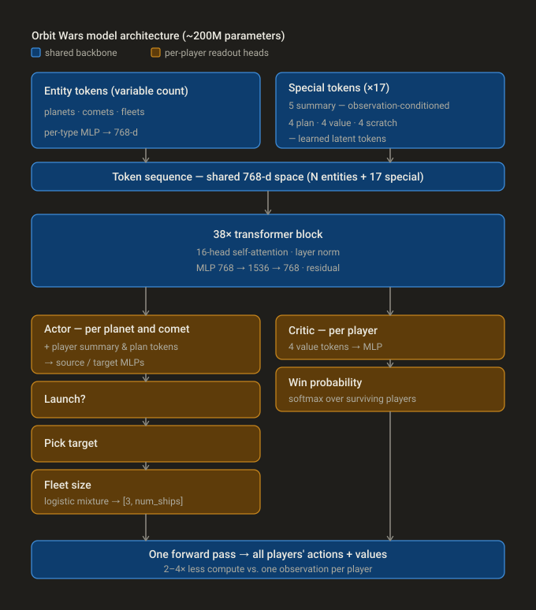

# 用强化学习扩展到星辰

IsaiahP · 第 1 名 · 14 天前

## 摘要

我训练了一个 2 亿参数的 Transformer，用 150 亿步自博弈强化学习，让它同时学会 Orbit Wars 的双人模式和四人模式。我已经把代码开源在原帖链接中。

## 动机

这次比赛里，我给自己设了几个目标和约束：

我想尝试完全由智能体参与的软件开发，所以不允许自己亲手写代码，并且尽量少做人工代码审查。

我希望模型尽可能靠自己学习，因此会使用尽量简单的观测空间和动作空间，同时仍然保持竞争力。这也意味着我坚持使用纯自博弈强化学习，不做任何模仿学习初始化。

我假设 Sutton 的“苦涩教训”会成立：只要训练足够多，一个表达能力足够强的大模型会胜过一个工程设计得更精巧的小模型。与其把时间花在为特征、动作和训练算法设计漂亮的领域专用改造上，我选择在提交限制内尽可能把模型规模推大。

## 智能体驱动的软件开发

Codex 极大加速了软件开发流程，让我在几周内就能跑起初步实验。刚开始我还会做一些人工审查，确认生成的东西大体合理；但很快我发现，自己主要只需要看生成出来的文档，确认它们是否符合我的意图。

这里也要加一个前提：Kaggle 比赛几乎是这类实验最理想的场景。一般来说，在比赛里尝试新想法很舒服，因为风险很低：如果最后变成一团糟，直接吸取教训、扔掉代码库就行。更具体地说，一个没有用户、没有线上系统要维护、没有向后兼容要求、出错成本也很低的全新项目，非常适合让编程智能体在较少人工干预下放开手脚去做。

我确实很惊讶它们能在不产生太多臃肿代码的情况下正确实现规格说明。不过，编程智能体提出建议和进行创造性设计的能力仍然经常不够好。这个工作流极大加速了开发，但它不能替代思考。

## 保持低层次的观测和动作编码

我一开始也考虑过像过去那样，仔细工程化每个特征、输入和动作编码。但我很好奇：如果不给模型这些“拐杖”，只使用在我看来合理的最低层表示，性能到底能推到多远。

我保留了原始、未聚合的观测空间：模型看到的是舰队、行星和彗星这些实体集合，再加上五个从观测中派生出的摘要 token：每个玩家位一个，全局一个。

动作空间也保持简单：模型需要直接选择是否发射、发射角度以及舰队规模。

经过一些超参数调整后，模型最终能学到一个勉强合理的策略。但距离有竞争力还差得很远，于是我修改了动作空间，让模型只需要选择目标行星，而不是直接输出原始角度。我还试过一些其他特征和动作编码，包括行星-舰队交叉注意力，以及离散化的舰队规模桶。它们看起来都没有必要，也不够简洁，所以我最后使用了完整的实体观测空间，加上基于目标选择的动作空间，并保留连续舰队规模，让模型自己学习其余动力学。

## 扩展模型规模

这是我方案的核心。正是模型规模让它能够弥补观测或动作编码中的不足，学习复杂的环境动力学，并达到最终表现。过程中有不少有意思的挑战，但总体假设成立了：把时间花在扩大训练规模上，并配合足够算力，比把时间花在设计领域专用的小模型方案上更有效。

## 实现细节

### 模型架构

输入由行星、彗星和舰队的一系列相关特征组成，例如径向位置、欧氏位置、速度、编码后的船数等。每类特征分别通过一个 MLP 投影到共享的 768 维表示中。我还加入了 17 个额外 token：4 个玩家摘要 token、1 个全局摘要 token、4 个 actor plan token、4 个 value token，以及 4 个 scratch token。玩家摘要 token 和全局摘要 token 由观测派生特征投影到 768 维隐藏空间，例如每个玩家的总船数、总产能、当前步数等。其余 token 使用可学习 embedding。scratch token 没有明确指定用途，只是作为注意力操作中的共享全局工作区。

所有 token 投影到同一个 embedding 空间之后，我把它们送入一个 38 层残差自注意力 Transformer。每层有 16 个注意力头，使用层归一化，并配有隐藏层维度为 1536 的 MLP。

对每个玩家来说，所有行星/彗星 token 会和该玩家的摘要 token、plan token 拼接在一起，然后分别经过 source MLP 和 target MLP。source 流会为每个合法来源投影出一个 Bernoulli logit，并据此采样是否从该来源发射舰队。对于决定发射的来源，目标选择采用一种类似自注意力的形式：

$$
\frac{\mathbf{Q(source)} \cdot \mathbf{K(target)}}{\sqrt{d}}
$$

随后，选中目标的 value 向量 $\mathbf{V(target)}$ 会加回 source 流，再送入一个由 8 个混合分量组成的截断离散 logistic mixture model，用来在 `[3, num_ships]` 范围内选择舰队规模。

critic 输出的计算方式是：将 value token 送入 MLP，再对所有仍存活玩家做 softmax，估计它们各自的获胜概率。所有动作会同时采样；计算 PPO loss 时，我会对每个玩家所有合法来源的联合概率进行计算。

借助这种架构，我可以在一次前向传播中同时为所有玩家计算动作，相比标准的“每个玩家一条观测”做法，节省了大约 2 到 4 倍计算量。

### 处理提交限制

早期实验中，我主要使用 100 万到 500 万参数的 Transformer。等确认实现正确、超参数也大致合理后，我开始扩大模型规模。每次增加参数量，性能都会显著提升，于是我一直扩展，直到遇到两个关键限制：

每回合只有 1 秒时间，加上 60 秒 overage time，而且运行在相对较慢的 CPU 上。

提交文件大小上限是 100 MiB。

为了在时间限制内完成推理，我对线性层使用 int8 量化，并限制可见舰队数量，优先保留最大的舰队。即便如此，在大约 8% 的四人游戏中，如果代理被分配到特别慢的 CPU，仍然不够快。因此在这些情况下，我会先正常下棋，直到只剩 1 秒 overage time，然后切换到一个快得多的 500 万参数模型打完剩余游戏。根据学习到的 critic，大多数游戏在切换时已经胜负已定，而这个 500 万模型能够 100% 转化它本来已经获胜的位置。

为了把 2 亿参数模型塞进 100 MiB，我使用了 4-bit NormalFloat codebook 量化，group size 为 128，每组保留一个 fp16 scale。用这种编码方式，量化模型能保留原模型的大部分性能；在与未量化模型的一对一评估中，它大约能赢 40%。为了尝试更大模型，我也试过一些 3-bit 编码方法，但 3-bit 量化带来的性能损失超过了“能放进更大模型”的收益，所以最终停在 2 亿参数。

### 重写环境

官方提供的 Python 环境对强化学习来说太慢了，所以我用 Rust 重写了环境。我用真实回放做了大量 parity test，确认模拟结果一致。另外，由于网络输出的是 `(source, target)` 动作对，我在 Rust 代码中计算所需角度，并尽量避开太阳和其他行星。Rust 环境还负责把原始观测转换成模型需要的张量格式。我预分配并复用 pinned memory buffer，以尽量减少 CPU-GPU 传输阻塞，并用多线程并行运行许多环境。

### 使用 PPO 做强化学习

我选择 PPO 而不是 IMPALA，是因为我喜欢 PPO 的简单性。另外，扩展 IMPALA 时需要仔细平衡数据采集器和训练器，而扩展 PPO 基本只需要增加 GPU 数量。我用分布式数据并行训练，发现吞吐量会随多节点和多 GPU 训练近似线性扩展。

训练时，我同时运行双人和四人游戏，权重相同。赢家奖励 +1，输家各自 -1。我使用纯自博弈来最大化吞吐量。双人模式中这没什么问题，但四人模式不太理想，因为它的均衡动态更复杂。我会定期把当前模型与上一个最佳检查点进行 head-to-head 评估，包括 1v1 和 2v2。只要当前模型在评估中胜率超过 70%，就替换掉之前的最佳检查点。除了标准的 GAE-λ 优势估计、裁剪策略梯度 loss、优势归一化和熵奖励之外，我还加入了相对上一个最佳检查点的 policy KL 项和交叉熵 value loss，用来稳定训练。

我频繁保存模型检查点，并在较大模型训练过程中偶尔 warm restart，以便调整超参数。我试过在训练中使用动作掩码，阻止模型做明显愚蠢的事，例如把船发射进太阳。但令我惊讶的是，这反而让模型变差。我猜原因可能是：不加掩码会迫使模型在内部学习更多物理规律，从而在其他方面提升表现。最后阶段我确实在一些微调中重新加入了掩码，并在测试时保留。

### 硬件与性能

这次 Orbit Wars 中，我不再受限于过去仿真比赛里用的那张 RTX 3090。我在一台 8xB200 机器上做了较大规模（大于等于 2500 万参数）的训练实验，使用 2048 个并行环境和 64 步 rollout。最后几天，我在四台 8xB200 节点上训练，共 8192 个并行环境。2 亿参数模型的训练速度约为每 GPU 小时 630 万步，也就是每 GPU 秒约 11 万 token；最终模型总共花了约 2400 个 B200 GPU 小时。

## 如果重来，我会改什么

### 拖延终局

我把 gamma，也就是未来回报折扣因子，设为 1.0（不折扣），这样四人游戏中的胜率价值头就能保持定义清晰。结果模型出现了一种很有意思的玩法：它没有动力“现在赢”而不是“以后赢”，所以经常只是取得船数领先，然后把游戏拖到结束。推理时这种行为没问题，但训练时并不理想，因为大量算力浪费在已经胜负已定的游戏上。下次我会考虑加入某种提前截断或投降机制，提高训练中有效状态的密度。

### 平衡双人和四人模式

比赛期间，顶尖玩家主要被安排到双人对局。我误以为这是官方有意为之，用来更好地区分榜首玩家，所以训练后半程我把双人游戏比例提高到了 90%。我也出于类似原因刻意没有实现任何 league play，因为它会牺牲双人吞吐量，用来稳定四人动态。

但最终提交截止后，榜首的四人/双人比例似乎完全反过来了：现在明显更偏向四人游戏。提交截止前后的匹配机制差异这么大，确实令人沮丧。如果我提前知道，我会让双人和四人比例更平衡，并加入与过去检查点对战的 league play，以帮助避免策略循环和自博弈过拟合。其他一些选手已经很好地证明了这种做法的效果。

## 结语

我要感谢组织者，尤其是 Bovard，设计并运营了这么有趣的一场比赛。看着所有代理彼此对战、尝试分析这些游戏并理解什么重要、什么不重要，是一件非常愉快的事。阅读大家的 write-up 也很棒，我已经学到了很多，期待下一次再见！
